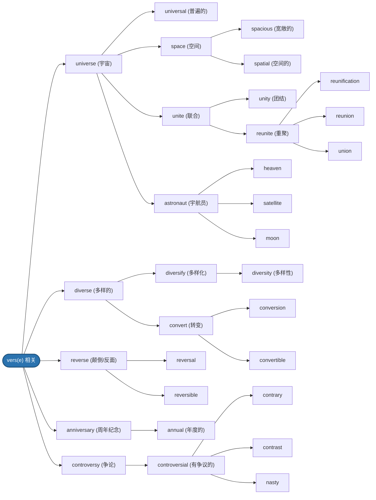

---

# 四级词汇复习

## Unit 1

### Lesson 1: 词以群记 1 —— vers(e) 相关

#### 关系脉络导图

#### 词汇记忆与遮罩自测（点击展开）

* **universe**
  

  
点击查看详情与派生

  - **中文释义**：n. 宇宙，世界
  - **扩充词汇**：universal (adj. 普遍的；宇宙的)
  - **联想群**：
    - `space` (空间) → spacious (宽敞的), spatial (空间的)
    - `unite` (联合) → unity (团结), reunite (重聚) → reunion (重聚), union (联合)
    - `astronaut` (宇航员) → satellite (卫星), heaven (天堂), moon (月球)
  

* **diverse**
  

  
点击查看详情与派生

  - **中文释义**：adj. 不同的，形形色色的
  - **扩充词汇**：diversify (v. 多样化) → diversity (n. 多样性)
  - **相关词**：convert (v. 转变) → conversion (n. 转变), convertible (adj. 可转换的)
  

* **reverse**
  

  
点击查看详情与派生

  - **中文释义**：v. 颠倒，反转；n. 背面，反面
  - **扩充词汇**：reversal (n. 颠倒，反转), reversible (adj. 可逆的)
  

* **anniversary**
  

  
点击查看详情与派生

  - **中文释义**：n. 周年纪念日
  - **相关词**：annual (adj. 每年的，年度的)
  

* **controversy**
  

  
点击查看详情与派生

  - **中文释义**：n. 公开辩论，争论
  - **扩充词汇**：controversial (adj. 引起争论的)
  - **辨析/相关**：contrary (相反的), contrast (对比), nasty (棘手的/令人厌恶的)
  
